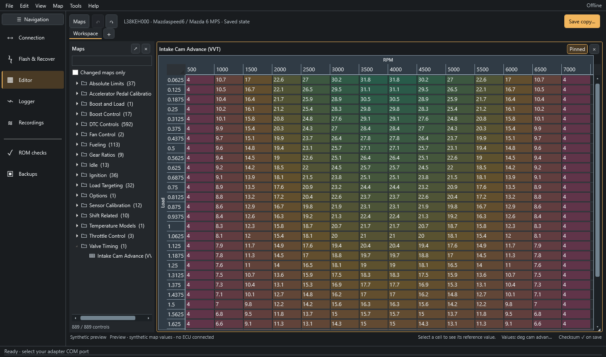
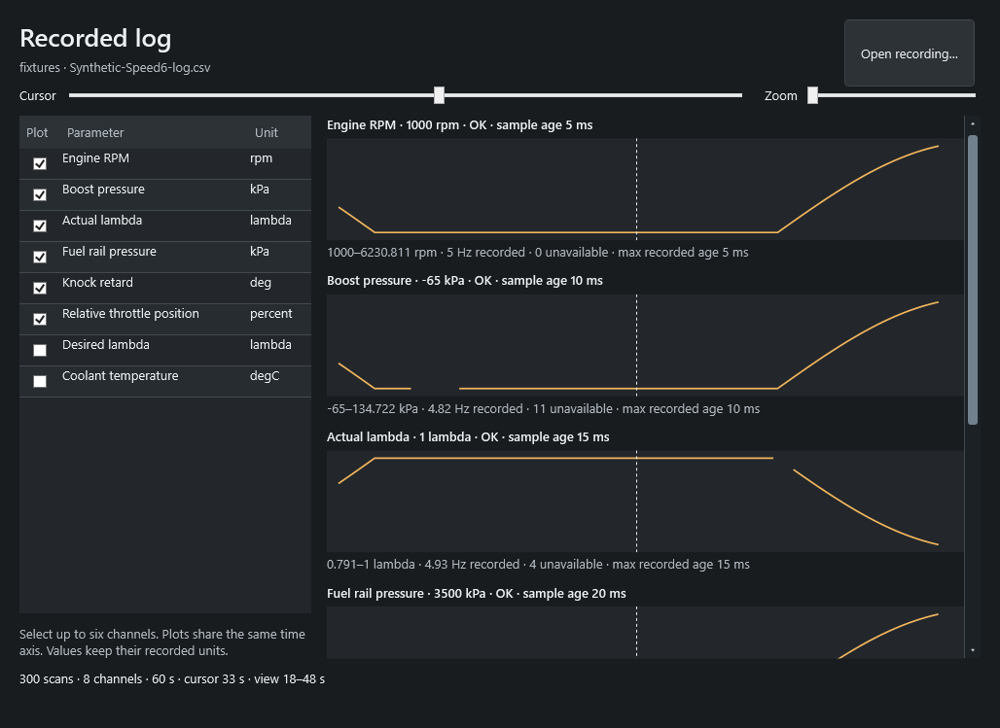
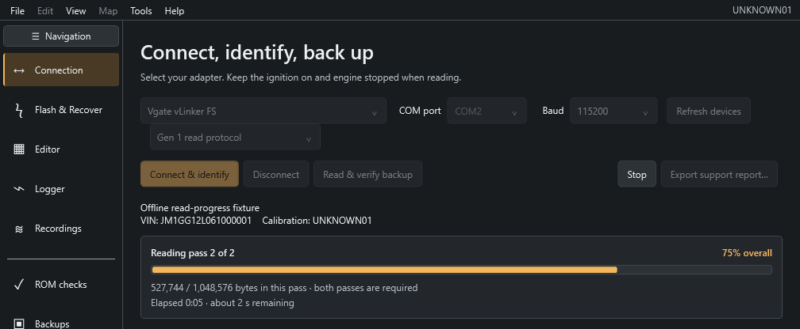

# SpeedLink

Open-source ROM reading, data logging, ROM editing, and Gen 1 flashing and recovery for Mazdaspeed and Mazda MPS.

**[Download v0.8.0-alpha.4](https://github.com/mrphyslaw/SpeedLink/releases/tag/v0.8.0-alpha.4)** · A single Windows EXE with the runtime included.

**Watch the 4-minute SpeedLink demo (4:11)**

https://github.com/user-attachments/assets/91f3d616-09c2-4cf5-926d-4642d296aaaa

See verified backups, real-ROM editing, 2D/3D views, saving and ROM checks,
logging and recorded-log review, definitions and built-in help.
**Real-ROM editing shown; ECU reading and logging simulated.**

Use the permanent File, Edit, View, Tools and Help menus throughout the app. Sidebar icons show their workspace names by default; collapse them when you want more map space. Open several maps in independently resizable panes or separate Windows windows. Auto fit preserves readable text and uses available cell spacing. Replace the EXE and keep your existing `data` folder. See [changes](CHANGELOG.md), the [editor guide](docs/EDITOR.md) and [reporting problems](docs/TROUBLESHOOTING.md).

Drag a pane's own edge or corner to resize just that map, or drag its title to
move it. Panes can overlap; click a map or select it in the browser to bring it
forward. **View → Map layout and display → Tile maps side by side** restores automatic arrangement.

SpeedLink can dump unknown 1 MiB MZR DISI ROMs, create two-pass verified backups,
log stock-ECU data, review recordings and edit the ten supported stock ROM layouts.
**Flashing and stock recovery are Gen 1 only**, covering all nine bundled Gen 1
ROM layouts. Open **Flash & Recover** below **Connection**. Pick the ROM to
write and SpeedLink looks up the ECU's verified original by VIN or chassis ID
and calibration. Recovery lists saved runs by date and calibration, checks the
ECU state, and finds the exact backup automatically. Normal writes offer two, one, or zero full
readbacks. The zero-readback result is marked unverified. Recovery requires
two matching readbacks. **Gen 2 flashing is planned for an upcoming
release.** SpeedLink ships without ROM files or adapter drivers.
[Flashing and recovery guide](docs/FLASHING.md)

Tactrix Openport 2.0 and vLinker FS have physical write coverage.
Mongoose-Plus ISO/CAN3 is available for experimental Gen 1 flashing and recovery.

Connect & identify accepts standard VINs and supported short chassis-number
replies, including space/null-padded identifiers reported by some ECUs. A chassis
ID is labeled separately; it does not select or authorize a different ROM/logger profile.

**Experimental Gen 2:** L3CGEE000 adds 442 editor controls and a 20-parameter
stock-ROM logger. Compatible unknown Gen 2 ROMs can be dumped by selecting the
Gen 2 read protocol. Real ECU validation is pending; see the [Gen 2 guide](docs/GEN2.md).

## A look inside

### ROM editor

Browse related maps, edit the grid, compare values and inspect 2D curves or
rotatable 3D surfaces. [More editor screenshots and a first-edit walkthrough →](docs/editor/README.md)
Axis headers have a distinct background and bright separators. **Map info**
inside each map pane, or **F1**, shows units, correction direction and practical examples.
Axis titles stay centered beside the visible rows and above the visible columns,
including short tables with unused space. [See the alignment example →](docs/editor/README.md#axis-titles-follow-the-data)
The map-window preview uses synthetic example values.

Single values use compact cards that wrap across the workspace, with units,
help and baseline comparison. Rejected ROM files leave the current editing
session available, including unsaved changes and open map windows.
Small maps stay proportional to their contents, and the table/preview divider
can be dragged to resize it. See the [editor guide and screenshots](docs/editor/README.md).
The gallery's layout and MAF examples use synthetic values. Screenshots are not
tuning recommendations.

### Logging and recordings

Record selected parameters to CSV, then review up to six synchronized plots
without an adapter. This preview uses synthetic example data; it does not show
a vehicle test or measured ECU logging rates.
After Stop, **View recording…** opens the session just saved. Live charts reuse
their views to reduce redraw allocations; polling and recording retain their
existing timing and data precision.
[Live logger screenshots and a quick start →](docs/logger/README.md)

## Choose a workflow

| Task | Start here |
| --- | --- |
| Dump an unknown ROM and help add support | [Guided ROM-dump workflow](docs/DUMP_A_ROM.md) |
| Edit a ROM: map grid, 2D curves and 3D surfaces | [Editor overview and screenshots](docs/editor/README.md) |
| Editing operations, comparison and saving | [Editor guide](docs/EDITOR.md) |
| Understand map units, corrections and thresholds | [Tuning guide](docs/TUNING_HELP.md) |
| See the logger, record parameters and review logs | [Logger overview and screenshots](docs/logger/README.md) |
| Logger setup, rates, units and troubleshooting | [Logger guide](docs/LOGGER.md) |
| Check ROM/profile compatibility | [Supported ROMs](docs/SUPPORTED_ROMS.md) |
| Report a connection, read, logger or app problem | [Export a support report](docs/TROUBLESHOOTING.md) |
| Build from source or review validation | [Documentation index](docs/README.md) |
| Install editor or logger definition updates | [Definition import](docs/DEFINITIONS.md) |

## Edit a ROM

The Workbench keeps editing, logging and recordings in one window. **Fit map**
gives the table the available workspace. A permanent **File / Edit / View / Tools / Help**
menu stays available throughout the app. Navigation shows icons and names by default
and remembers your choice to collapse it;
the map browser and graph can be resized, hidden or moved into separate windows.
Use **View** for layout options, map information and changed maps. 3D tables can
keep a small surface preview at the upper-right of the grid; MAF curves keep
their value list on the left and graph on the right.
Axis names sit directly above the column breakpoints and beside the row
breakpoints. Selected row and column headers highlight together; value units
stay inside the map's header. 3D maps carry labeled axis rulers and tick values
directly on their frame, aligned with the surface as it rotates.

1. Open **Editor**, then **File → Open ROM…**.
2. Select a map from the categorized list or use search. Related numbered maps
   are kept together. Maps open together in resizable panes with their units and tuner help.
3. For a single value, type in the field and choose **Apply** or Enter;
   Cancel or Escape discards typing. For a table, double-click a cell or apply
   arithmetic, paste or interpolation to a selection. State controls use named
   choices. Compare with the original, last save or another compatible ROM;
   Undo/Redo restores operations. Review a curve or surface when available.
4. Choose **Save copy…**. Every save applies the ROM-specific checksum/integrity checks, then
   creates and verifies a new file; the original and existing copies are preserved.

Editing needs no adapter. Supported tuning profiles are **L33XEH000, L35HEH000,
L38KEH000, L39SED000, L39SEE000, L39SEF000, L3M6EG000, L3M7EF000, L3P4EM000 and L3CGEE000**. A matching calibration,
boot and program area are required. Patched/extended ROM layouts are unsupported.
Static axes are read-only. See the [editor guide](docs/EDITOR.md) for details.

Long MAF curves use a breakpoint/value list beside a zoomable curve. Click a
point to reach its value, including either end of a 129-point calibration.
Layout preferences are saved beside the EXE in `data/editor-layout.json`.

Choose **Tools → Manage definitions…** to import editor XML or logger JSON updates for supported
ROM layouts. Updates are kept in `data/definitions` beside the EXE; the bundled
copies remain available. See [definition import](docs/DEFINITIONS.md).

## Report a problem

Capture starts automatically before the adapter opens. After a problem, choose
**Connection → Export support report…**, select the failed session and save its
ZIP. You can do this after restarting without reconnecting. Follow the
[reporting guide](docs/TROUBLESHOOTING.md) and attach it to the
[problem-report form](https://github.com/mrphyslaw/SpeedLink/issues/new?template=bug-report.yml).
Factory seed/key exchanges are retained; personal information is redacted and
ROM bytes stay in your backups.

## Read and back up a ROM

[Adapter status and testing candidates](docs/ADAPTERS.md) distinguishes available
adapter paths from hardware awaiting qualification.
**Mongoose-Plus ISO/CAN3** is available as an experimental J2534 reader/logger
option for user testing; hardware validation is pending. See the guide for
driver setup and reporting results.

**First time, or contributing an unknown ROM?** Follow the
[step-by-step ROM-dump workflow](docs/DUMP_A_ROM.md), then use the
[guided ROM-support request](https://github.com/mrphyslaw/SpeedLink/issues/new?template=rom-support.yml).

1. Download **SpeedLink.exe** from [Releases](https://github.com/mrphyslaw/SpeedLink/releases).
2. Save it in a writable folder and double-click it. No installer or .NET installation is needed.
3. Connect a **Vgate vLinker FS USB** or **Tactrix Openport 2.0** with its manufacturer's driver installed. Select the adapter in SpeedLink; vLinker also needs its COM port.
4. Turn the ignition on with the engine stopped, then select **Connect & identify**.
5. For an unknown Gen 2 ECU, select **Gen 2 read protocol (experimental)**; known ROMs choose automatically. Select **Read & verify backup**. SpeedLink saves a verified backup after two complete reads match.

The progress panel shows both passes, elapsed time and an estimate based on
measured read speed. It reaches 100% after verification and saving finish.
This screenshot uses a synthetic offline test; its timing is not a vehicle
read-speed measurement. [Progress and result screenshots →](docs/DUMP_A_ROM.md#3-read-and-verify)

Backups are saved in the `data` folder beside the EXE. Keep the whole backup
folder, including its captures, manifest and journal.

## Log engine data

You need a full backup of the ROM currently installed in the ECU. SpeedLink uses
it to choose the logging profile and read the MAP sensor calibration. The current
logger supports [ten defined ROMs](definitions/logging/All_ROM_Coverage.md).

1. Connect the adapter and select **Connect & identify**. If you just read a ROM,
   disconnect and reconnect before logging.
2. Open **Logger**, select **Load current ECU ROM…**, and choose that current ROM
   backup. Its calibration ID must match the connected ECU.
3. Choose **Essentials** for a starting selection, or select the parameters you
   need. Set each row's display unit. Fewer selected parameters allow faster updates.
4. Leave mixture readings in lambda, or enter your fuel's stoichiometric AFR
   before choosing an AFR display unit.
5. Leave **Record CSV** checked and select **Start logging**. Use the **Plot** column
   to choose up to six synchronized charts for logged parameters. The **Hz** column shows its measured sample rate;
   **Polling → Max** collects data without a scan-rate delay. Numeric limits are optional; the **Hz** column shows achieved rates.
6. Select **Stop** to finish the recording. The healthy connection stays ready for
   **Start logging** again, with your ROM and selections retained. Each start creates
   a separate recording. Use **Open logs** to find them under `data/logs` beside the EXE.
   Disconnect and reconnect before switching from logging to a ROM backup read.

Logging can run with the engine running. **ROM backup reads require the engine
stopped.** Unknown ROMs can still be dumped; logging requires a supported profile.
See the [logger guide](docs/LOGGER.md) for setup, recordings and troubleshooting.

## Review a recording

1. Choose **Recordings** in the left navigation. No adapter is needed.
2. Select **Open recording…** and choose the recording folder's `log.csv`.
3. Select up to six parameters. Move the shared cursor or click a plot to inspect
   readings, and use **Zoom** to focus on part of the recording. Missing data appears
   as gaps; the viewer also shows sample ages and recorded rates.

Keep the whole recording folder, including `responses.jsonl` and `session.json`,
locally. Start troubleshooting with a [support ZIP](docs/TROUBLESHOOTING.md);
review any recording separately before deliberately sharing it.

## ROM checks

Known-ROM checks and checksum correction are available under **ROM checks**.
Checksum correction saves a separate file. Unknown ROMs do not need to pass these
checks to be read and saved.

See [ROM checks and compatibility](docs/SUPPORTED_ROMS.md) for the known layouts.
Related RomRaider definitions are available in [MazdaSpeedDefs](https://github.com/mrphyslaw/MazdaSpeedDefs).

## Status and development

- **Available:** ROM reading, two-pass verified backups, known-ROM checks and
  checksum correction to a separate file; live logging, charts, CSV recording
  and saved-log viewing; offline ROM editing, comparison, 2D/3D views and undo/redo.
  The reader covers the 1 MiB MZR DISI ECU family.
- **Logger coverage:** nine Gen 1 profiles with 33–38 stock-ROM parameters each,
  plus experimental L3CGEE000 Gen 2 logging with 20 parameters.
  No logging patch is required. See [coverage and exclusions](definitions/logging/All_ROM_Coverage.md).
- **Fixed:** logger matching accepts known complete ECU calibration IDs, including
  `L3P4EM000L3T6051`. Renaming a ROM file is unnecessary.
- **Checked:** 615 C# tests, 2,631 native-derived logger vectors and 45 standard-batch equivalence cases. Ten-profile
  editor checks cover direct cell entry, comparison, undo/redo and byte-identical
  no-edit exports. L3CGEE000 adds 379 native logger instruction checks and complete
  reference-ROM cell/axis comparisons. See [validation](docs/VALIDATION.md).
  Earlier physical logger tests passed with vLinker FS and Tactrix across the
  original seven Gen 1 profiles, including fault handling, sustained requests
  and USB recovery. Isolated Gen 2 simulated-peer reads and logging have also
  passed using vLinker FS and Tactrix; this does not establish real ECU acceptance. Saved-log viewing and
  standalone EXE checks also passed.
- **Logging performance:** Max polling is the default. Both wired adapters completed
  over 25,000 read-only requests combined on one L3M6EG000 bench ECU, including
  three-minute all-parameter recordings and repeated desktop Start/Stop sessions.
  See [measured rates and scope](docs/LOGGER_PERFORMANCE.md).
- **Still pending:** broader Mazda ECU read coverage, physical sensor readings,
  running-engine behavior and achievable vehicle logging rates. The 346 channel/profile
  vehicle validation checks remain pending.
- **Gen 1 programming:** Nine bundled layouts pass the offline write and recovery
  matrix. Both supported adapters completed edited and stock writes on one
  L3M6EG000 bench ECU. Tactrix also completed recovery after a controlled
  interruption. Broader hardware qualification and Gen 2 flashing are upcoming.
  [Validation scope](docs/VALIDATION.md)

Validation distinguishes simulated ECU replies over real adapters from tests
on a powered ECU. Matching ROM reads verify the captured bytes across both
passes. Unknown calibration IDs can be read with a compatible read protocol.

See [usage notes](docs/USAGE.md), [build instructions](docs/BUILD.md), and
[contributing](CONTRIBUTING.md) for more information. Help and license notices
are also included in the EXE.

See the [C#/.NET source](dotnet/README.md) and
[validation results](dotnet/docs/Validation.md) for the completed checks and remaining work.

## License

Released under [GPL-3.0-or-later](LICENSE). See [attributions](ATTRIBUTIONS.md).
