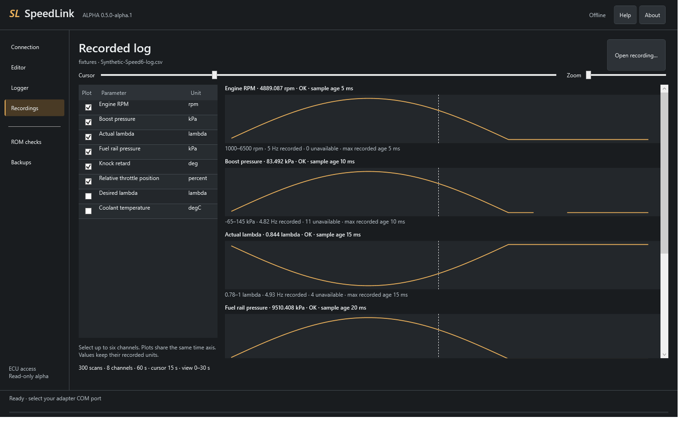

# SpeedLink

Open-source ROM reading, data logging and offline ROM editing for Mazdaspeed and Mazda MPS.

**[Download v0.5.4-alpha.1](https://github.com/mrphyslaw/SpeedLink/releases/tag/v0.5.4-alpha.1)** — a single Windows EXE, with no installer or .NET installation required.

SpeedLink can dump unknown 1 MiB MZR DISI ROMs, create two-pass verified backups,
log stock-ECU data, review recordings and edit the seven supported stock ROM layouts.
ECU access remains read-only: **flashing is disabled**. ROM files and adapter drivers
are not bundled. Real Mazda ECU validation remains pending.

## A look inside

### ROM editor

Browse related maps, edit the grid, compare values and inspect 2D curves or
rotatable 3D surfaces. [More editor screenshots and a first-edit walkthrough →](docs/editor/README.md)
The layout and MAF examples use synthetic values; the VVT surface shows an
L38KEH000 ROM example. Screenshots are not tuning recommendations.

### Logging and recordings

Record selected parameters to CSV, then review up to six synchronized plots
without an adapter. This preview uses synthetic example data; it does not show
a vehicle test or measured ECU logging rates.
[Live logger screenshots and a quick start →](docs/logger/README.md)

## Choose a workflow

| Task | Start here |
| --- | --- |
| Dump an unknown ROM and help add support | [Guided ROM-dump workflow](docs/DUMP_A_ROM.md) |
| Edit a ROM: map grid, 2D curves and 3D surfaces | [Editor overview and screenshots](docs/editor/README.md) |
| Editing operations, comparison and saving | [Editor guide](docs/EDITOR.md) |
| See the logger, record parameters and review logs | [Logger overview and screenshots](docs/logger/README.md) |
| Logger setup, rates, units and troubleshooting | [Logger guide](docs/LOGGER.md) |
| Check ROM/profile compatibility | [Supported ROMs](docs/SUPPORTED_ROMS.md) |
| Build from source or review validation | [Documentation index](docs/README.md) |
| Install editor or logger definition updates | [Definition import](docs/DEFINITIONS.md) |

## Edit a ROM

The Workbench keeps editing, logging and recordings in one window. **Fit map**
gives the table the available workspace. The app navigation collapses to icons;
the map browser and graph can be resized, hidden or moved into separate windows.
Use **View** for layout options, map information and changed maps. 3D tables can
keep a small surface preview at the upper-right of the grid; MAF curves keep
their value list on the left and graph on the right.
Axis names sit directly above the column breakpoints and beside the row
breakpoints. Selected row and column headers highlight together; value units
stay beside the map tabs.

1. Open **Editor**, then **File → Open ROM…**.
2. Select a map from the categorized list or use search. Related numbered maps
   are kept together. Each map opens in a tab with its units and tuner help.
3. Edit the grid or apply arithmetic, clipboard values or interpolation to a
   selection. Review the 2D curve or rotate and zoom the 3D surface. Compare with
   the original, last save or another compatible ROM; Undo/Redo restores operations.
4. Choose **Save copy…**. Every save corrects and verifies the checksum, then
   creates and verifies a new file; the original and existing copies are preserved.

Editing needs no adapter. Supported tuning profiles are **L33XEH000, L35HEH000,
L38KEH000, L39SED000, L39SEE000, L39SEF000 and L3M7EF000**. A matching calibration,
boot and program area are required. Patched/extended ROM layouts are unsupported.
Static axes are read-only. See the [editor guide](docs/EDITOR.md) for details.

Long MAF curves use a breakpoint/value list beside a zoomable curve. Click a
point to reach its value, including either end of a 129-point calibration.
Layout preferences are saved beside the EXE in `data/editor-layout.json`.

Select **Definitions** to import editor XML or logger JSON updates for supported
ROM layouts. Updates are kept in `data/definitions` beside the EXE; the bundled
copies remain available. See [definition import](docs/DEFINITIONS.md).

## Read and back up a ROM

**First time, or contributing an unknown ROM?** Follow the
[step-by-step ROM-dump workflow](docs/DUMP_A_ROM.md), then use the
[guided ROM-support request](https://github.com/mrphyslaw/SpeedLink/issues/new?template=rom-support.yml).

1. Download **SpeedLink.exe** from [Releases](https://github.com/mrphyslaw/SpeedLink/releases).
2. Save it in a writable folder and double-click it. No installer or .NET installation is needed.
3. Connect a **Vgate vLinker FS USB** or **Tactrix Openport 2.0** with its manufacturer's driver installed. Select the adapter in SpeedLink; vLinker also needs its COM port.
4. Turn the ignition on with the engine stopped, then select **Connect & identify**.
5. Select **Read & verify backup**. SpeedLink saves a verified backup after two complete reads match.

Backups are saved in the `data` folder beside the EXE. Keep the whole backup
folder, including its captures, manifest and journal.

## Log engine data

You need a full backup of the ROM currently installed in the ECU. SpeedLink uses
it to choose the logging profile and read the MAP sensor calibration. The current
logger supports [seven defined ROMs](definitions/logging/All_ROM_Coverage.md).

1. Connect the adapter and select **Connect & identify**. If you just read a ROM,
   disconnect and reconnect before logging.
2. Open **Logger**, select **Load current ECU ROM…**, and choose that current ROM
   backup. Its calibration ID must match the connected ECU.
3. Choose **Essentials** for a starting selection, or select the parameters you
   need. Set each row's display unit. Fewer selected parameters allow faster updates.
4. Leave mixture readings in lambda, or enter your fuel's stoichiometric AFR
   before choosing an AFR display unit.
5. Leave **Record CSV** checked and select **Start logging**. Use the **Plot** column
   to choose up to six synchronized charts for logged parameters. The **Hz** column shows its measured sample rate;
   **Target scans/s** is a ceiling, not a guaranteed rate.
6. Select **Stop** to finish the recording and disconnect. Use **Open logs** to
   find it under `data/logs` beside the EXE. Reconnect before another logging session.

Logging can run with the engine running. **ROM backup reads require the engine
stopped.** Unknown ROMs can still be dumped; logging requires a supported profile.
See the [logger guide](docs/LOGGER.md) for setup, recordings and troubleshooting.

## Review a recording

1. Open **Logger** and select **Recordings**. No adapter is needed.
2. Select **Open recording…** and choose the recording folder's `log.csv`.
3. Select up to six parameters. Move the shared cursor or click a plot to inspect
   readings, and use **Zoom** to focus on part of the recording. Missing data appears
   as gaps; the viewer also shows sample ages and recorded rates.

Keep the whole recording folder, including `responses.jsonl` and `session.json`,
when sharing data for troubleshooting.

## ROM checks

Known-ROM checks and checksum correction are available under **ROM checks**.
Checksum correction saves a separate file. Unknown ROMs do not need to pass these
checks to be read and saved.

See [ROM checks and compatibility](docs/SUPPORTED_ROMS.md) for the known layouts.
Related RomRaider definitions are available in [MazdaSpeedDefs](https://github.com/mrphyslaw/MazdaSpeedDefs).

## Status and development

**Current release: [v0.5.4-alpha.1](https://github.com/mrphyslaw/SpeedLink/releases/tag/v0.5.4-alpha.1), a Windows Workbench alpha.**

- **Available:** ROM reading, two-pass verified backups, known-ROM checks and
  checksum correction to a separate file; live logging, charts, CSV recording
  and saved-log viewing; offline ROM editing, comparison, 2D/3D views and undo/redo.
  The reader covers the 1 MiB MZR DISI ECU family.
- **Logger coverage:** seven ROM profiles with 35–38 stock-ROM parameters each.
  No logging patch is required. See [coverage and exclusions](definitions/logging/All_ROM_Coverage.md).
- **Checked:** 261 C# tests, 2,030 native-derived logger vectors and 174,741
  independently decoded editor values/switches. Seven-profile editor desktop
  checks cover direct cell entry, comparison, undo/redo and byte-identical no-edit
  exports. See [validation](dotnet/docs/Validation.md). Physical
  logger tests passed with vLinker FS and Tactrix across all seven profiles,
  including fault handling, sustained requests, desktop controls and USB recovery.
  Saved-log viewing and standalone EXE checks also passed.
- **Still pending:** real Mazda ECU read/logging acceptance, sensor readings and
  achievable vehicle logging rates. All 258 channel/profile ECU checks remain pending.
- **Planned:** ECU flashing. Live programming is disabled in this release.

Bench testing uses simulated ECU replies over real adapters. A matching pair of
ROM reads verifies consistency; it does not establish factory provenance or
compatibility with another vehicle. Unknown ROMs remain readable without a definition.

See [usage notes](docs/USAGE.md), [build instructions](docs/BUILD.md), and
[contributing](CONTRIBUTING.md) for more information. Help and license notices
are also included in the EXE.

See the [C#/.NET source](dotnet/README.md) and
[validation results](dotnet/docs/Validation.md) for the completed checks and remaining work.

## License

Released under [GPL-3.0-or-later](LICENSE). See [attributions](ATTRIBUTIONS.md).
