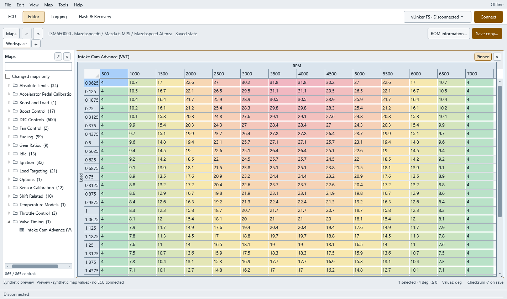

# SpeedLink

SpeedLink is an open-source Windows tool for backing up, editing, and logging
Mazdaspeed and Mazda MPS ECUs. It also reads and clears engine fault codes
and supports flashing and recovery for compatible Gen 1 ECUs.

**[Download SpeedLink v0.8.0-alpha.18](https://github.com/mrphyslaw/SpeedLink/releases/download/v0.8.0-alpha.18/SpeedLink.exe)** · A portable Windows EXE with the runtime included.

[Release notes](https://github.com/mrphyslaw/SpeedLink/releases/tag/v0.8.0-alpha.18) · [All releases](https://github.com/mrphyslaw/SpeedLink/releases)

## Compatibility

| ECU | Available workflows |
| --- | --- |
| **Gen 1 Mazdaspeed3, Mazdaspeed6, and Mazda MPS** | Ten bundled ROM layouts support editing, stock ECU logging, flashing, and recovery. Flashing requires a verified original backup from the same ECU. |
| **Gen 2 Mazdaspeed3 / Mazda3 MPS** | The **L3CGEE000** profile supports experimental editing and logging. Compatible Gen 2 ROMs can be read. Gen 2 flashing is planned. |
| **Mazda CX-7 2.3 DISI Turbo (2007 automatic, reported)** | Added in the current source. The **L37JEF000** profile supports offline editing and verified checksum-corrected exports. |
| **Unknown compatible 1 MiB MZR DISI ROMs** | Select the appropriate read protocol to capture and verify a backup. Editing and logging require matching profiles. |

Check your calibration against the [supported ROM list](docs/SUPPORTED_ROMS.md).
Engine diagnostics can run with a supported adapter before you load a ROM.

**Adapters** · Vgate vLinker FS USB and Tactrix Openport 2.0 are the primary
wired options. Mongoose-Plus ISO/CAN3 is experimental. Install your adapter
manufacturer's Windows driver and check the [adapter guide](docs/ADAPTERS.md)
for driver requirements and tested workflows. Supply your own ROM or read it
from your ECU.

## Getting started

1. Save **SpeedLink.exe** in a writable folder and open it.
2. For ECU work, connect your adapter and select its COM port or driver in the
   shared connection bar. Turn the ignition on with the engine stopped, then select **Connect**.
3. Choose **ECU → Read backup → Read & verify backup**. SpeedLink verifies the
   backup after two complete reads match. Keep the full backup folder in `data`
   alongside the EXE.
4. Use **ECU → Saved backups** to reopen the verified ROM in the Editor.
   For live logging, load the ROM currently installed on the ECU in **Logging → Live**.
   Follow the [flashing guide](docs/FLASHING.md) before writing to a Gen 1 ECU.

You can **open a supported ROM** in the Editor or **replay a saved CSV**
from Logging with the adapter disconnected. When updating SpeedLink, replace
the EXE and keep your existing `data` folder.

### Video walkthrough · 7:53

Follow a first backup through editing, logging, diagnostics, and Gen 1 recovery.
The demo uses a stock Mazda ROM and simulated ECU sessions.

https://github.com/user-attachments/assets/220d0312-ad01-48b8-8138-2b1ac9145a07

## What you can do

| SpeedLink section | What it does | Guide |
| --- | --- | --- |
| **ECU** | Read and verify a backup, browse saved backups, and review engine fault codes, readiness, and freeze-frame data. | [Back up a ROM](docs/DUMP_A_ROM.md) · [Engine diagnostics](docs/DIAGNOSTICS.md) |
| **Editor** | Find and compare maps, inspect 2D curves and 3D surfaces, and organize pinned maps in named workspaces. Save changes to a new file with a verified checksum. | [Editor](docs/EDITOR.md) · [Tuning](docs/TUNING_HELP.md) |
| **Logging** | Record selected ECU parameters to CSV. Review recordings offline with synchronized plots, a shared cursor, and zoom. | [Logging and replay](docs/LOGGER.md) |
| **Flash & Recovery** | Write a compatible Gen 1 ROM, verify a saved write, or restore the verified original after an interrupted write. | [Gen 1 flashing and recovery](docs/FLASHING.md) |

[Editor screenshots](docs/editor/README.md) · [Logger screenshots](docs/logger/README.md) · [Navigation and shortcuts](docs/NAVIGATION.md) · [All user guides](docs/README.md)

## Get help

- **Connection or app problem?** Choose **Help → Export support report…**.
  Review the ZIP before attaching it to the [problem-report form](https://github.com/mrphyslaw/SpeedLink/issues/new?template=bug-report.yml).
  [Troubleshooting guide](docs/TROUBLESHOOTING.md)
- **Missing ROM support?** Follow the [ROM-dump guide](docs/DUMP_A_ROM.md),
  then open a [ROM-support request](https://github.com/mrphyslaw/SpeedLink/issues/new?template=rom-support.yml).
- **Updating definitions?** See [definition import](docs/DEFINITIONS.md) and the
  related [MazdaSpeedDefs project](https://github.com/mrphyslaw/MazdaSpeedDefs).

## Development

[Build from source](docs/BUILD.md) · [C# implementation](dotnet/README.md) · [Contributing](CONTRIBUTING.md) · [Changelog](CHANGELOG.md)

See the [validation guide](docs/VALIDATION.md) for physical bench and simulated
test coverage, and the [logger performance guide](docs/LOGGER_PERFORMANCE.md)
for measured rates and test conditions.

## License

[GPL-3.0-or-later](LICENSE) · [Attributions](ATTRIBUTIONS.md)
