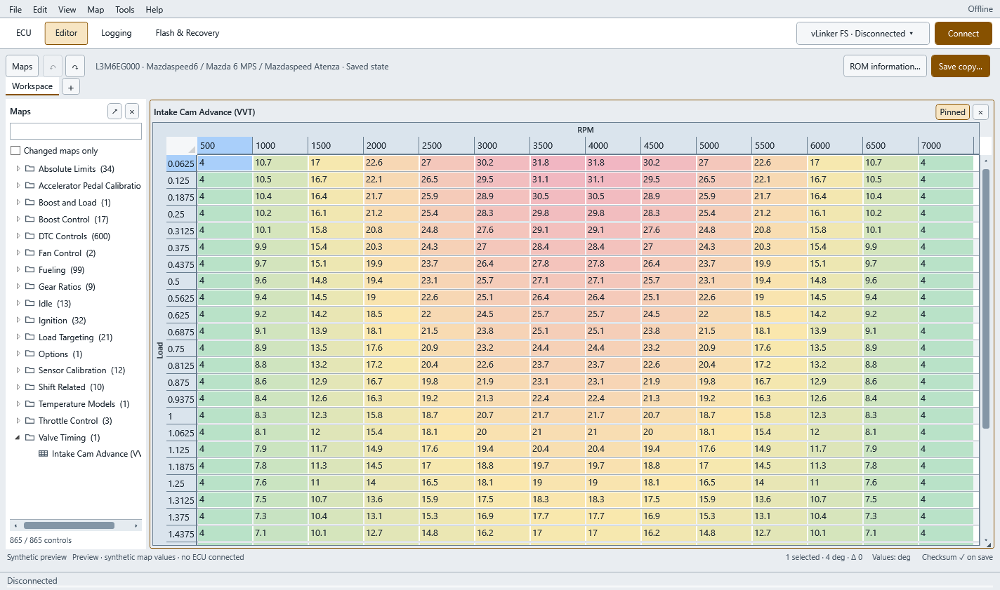
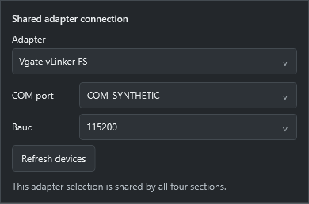

# Navigation and shared connection

SpeedLink has four sections across the top. The adapter dropdown and
**Connect / Disconnect** stay available in all four. Choose the COM port and baud
for vLinker FS, or the registered J2534 driver for Tactrix or experimental Mongoose,
in that dropdown. **Refresh devices** refreshes the available ports and drivers.

| Section | Views and actions |
| --- | --- |
| **ECU** | **Diagnostics**, **Read backup**, and **Saved backups** |
| **Editor** | Maps, named layouts, and **ROM information…** beside Save copy |
| **Logging** | **Live** and **Recordings** |
| **Flash & Recovery** | Gen 1 writing, recovery-state checks, and stock recovery |

Switching sections preserves the open ROM, unsaved edits, map layouts, recording
viewer and ordinary adapter connection. Each section remembers its last view
while the app is open. Editing and reviewing recordings work without an adapter.
The editor's **ROM information…** inspects the document's most recently saved
file. Its heading identifies this as saved-file inspection; unsaved edits remain
in Maps. Choose **Maps** to return to the same editing workspace.

## Work with the connected ECU

Open **ECU → Diagnostics** to read engine fault codes, readiness and available
freeze frame. **Connect & read codes** uses the shared adapter selection and stays
on Diagnostics. No ROM is required. See the [diagnostics guide](DIAGNOSTICS.md).

Use **ECU → Read backup** for two matching ROM reads and retained verification
records. Known ROMs select their read protocol automatically; choose the generation
there for an unknown ROM. **Saved backups** lists retained operations, including
interrupted reads. See [reading a ROM](DUMP_A_ROM.md).

## Keep an operation visible

Reading, logging and diagnostic operations keep a status strip and **Stop** action
visible when you switch sections. The bottom progress indicator stays visible.
Only one adapter operation may run at a time. Stop logging before diagnostics or
programming. A ROM-read session must be disconnected and reconnected before normal
logging or diagnostics; do that from the shared controls in the current section.

Opening **Flash & Recovery** preserves an idle ordinary connection. Before a
flash-related ECU-state check, identification or write, SpeedLink closes that
ordinary session and opens the existing exclusive programming transport for the
same selected adapter. An active read, log or diagnostic operation blocks this
handoff. There is no need to visit another page or manually close an idle session.

While programming uses the adapter, selection, Connect/Disconnect and section
navigation are locked. The flashing workflow retains its own stage-dependent Stop
rules and confirmation prompts. When its transport closes, the shared controls
show Disconnected; reconnect there for normal ECU communication. **Flashing and
recovery remain Gen 1 only. Gen 2 flashing is planned.** See [flashing and
recovery](FLASHING.md).

## Existing shortcuts and settings

Existing navigation shortcuts still open the corresponding grouped view:

| Default | Destination |
| --- | --- |
| Ctrl+1 | ECU → Read backup |
| Ctrl+2 | Editor → Maps |
| Ctrl+3 | Logging → Live |
| Ctrl+4 | Logging → Recordings |
| Ctrl+5 | Editor → ROM information |
| Ctrl+6 | ECU → Saved backups |
| Ctrl+7 | Flash & Recovery |
| Ctrl+8 | ECU → Diagnostics |

Custom bindings remain under **Tools → Keyboard shortcuts**. Map panes, pins,
workspace tabs, browser sizing and appearance use their existing settings. The
old application-sidebar collapse preference is obsolete; it does not reset map
layouts. Ctrl+B still hides or restores the editor's map browser.

The screenshots use synthetic examples and do not show a live ECU operation.
