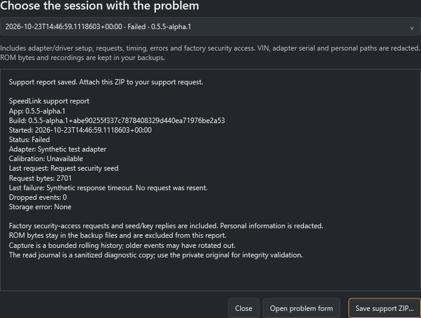

# Report a problem

SpeedLink saves diagnostic details automatically whenever you choose **Connect &
identify**. Capture begins before the adapter driver opens. You do not need to
enable a debug mode or successfully connect first.

## Send a support report

1. Note what you selected and what happened. Copy the exact error if available.
   For a ROM read, mention whether either read pass made progress.
2. Open **Connection → Export support report…**. After a crash or restart,
   open the app again and use the same button; reconnecting is unnecessary.
3. Choose the session at the time of the problem. The newest session appears
   first. Check its version, last request, failure and capture warnings in the
   preview. Choose **Save support ZIP…** and a new filename.
4. Choose **Open problem form** in the report window, or open the
   [problem-report form](https://github.com/mrphyslaw/SpeedLink/issues/new?template=bug-report.yml).
   Describe the steps, expected result and actual result. Include your vehicle,
   year/market, calibration if known, adapter and SpeedLink version.
5. Drag the ZIP into the form's **Support report** field, wait for the upload
   to finish, then submit. Screenshots can help explain a display problem.

Reports and issue attachments are public. Review the ZIP before posting it.
The report can be opened with Windows' ZIP viewer: `summary.txt` is the overview,
`environment.json` contains session details, and `events-*.jsonl` contains the
ordered diagnostic events. Keep your original backup and recording folders.

This screenshot uses a synthetic timeout; it does not show a vehicle test.

## What is captured

- App version/build, Windows/runtime and process architecture.
- Selected adapter, reported firmware/driver/API versions, CAN settings,
  serial setup and the configured read size and response deadlines.
- Diagnostic requests, response lengths, timings and errors, including the
  stage and ROM address/length being read. Short non-identity replies are
  included. Factory security-access requests, seed/key bytes, acknowledgements
  and negative replies are retained to investigate different ECU behavior.
- J2534 receive-poll, empty-poll, notification, pending and completed-reply
  counts, plus driver return/status and message-size details where available.
  From v0.5.5-alpha.2, reports also record the returned message count,
  messages accompanying timeout-like statuses, native receive-call duration and
  inconsistent extra-data indexes. Receive metadata contains no ROM payload.
- Exception details, capture warnings and a sanitized read-journal copy when
  a read created one. The copied journal omits its original integrity chain;
  the private original remains unchanged for backup validation.

These are host/driver diagnostics, not a raw CAN wire capture. Recording adds
no ECU requests and does not enable retries or change the read-only allowlist.
A report helps locate a failure; it does not establish the cause by itself.

A J2534 driver can return message data along with a timeout-like status. From
v0.5.5-alpha.2, SpeedLink validates any reported messages before treating the
result as an empty poll. This does not resend the request, extend the response deadline
or hide a fatal driver error. ISO15765 replies use their complete reported message
length; inconsistent extra-data indexes are retained in diagnostics.

VINs, adapter serial numbers and personal file paths are redacted. Calibration
IDs and the factory security exchange are retained. ROM payload bytes, full ROM
images, raw backup captures, CSV recordings, imported definitions and unrelated
files are excluded from the ZIP. ROM-read events retain the response length and
SHA-256 instead of duplicating the ROM. A ROM contribution is a separate,
deliberate step in the [ROM-dump guide](DUMP_A_ROM.md).

## Capture limits and local storage

Diagnostics live under `data/diagnostics` beside the EXE. Keep that `data` folder
when upgrading. The app keeps the ten newest sessions, each with up to four
2 MiB event segments. This is a rolling history: earlier events can rotate out
during a long session. Export soon after a problem. The summary also retains
the last request and failure. Queue-overflow omissions are counted in the report;
storage/omission warnings appear on Connection. Capture runs through a bounded
background writer. A diagnostic-storage error does not retry an ECU request or
turn a partial read into a verified backup.

You can delete old diagnostic session folders when SpeedLink is closed. This
does not remove ROM backups or CSV recordings. If export fails, the app preserves
existing files; choose a writable folder and a new ZIP name. If no session was
saved, attach the error/screenshot and describe the setup in the issue instead.

## Before trying again

Close other diagnostic applications, check the adapter's manufacturer driver,
and select the correct adapter/COM port or J2534 library. A transport timeout or
malformed reply requires a fresh connection; SpeedLink does not resend the
failed request. Preserve the report from the failed session first. Keep the
ignition on and engine stopped for ROM reads. Logging needs a supported profile
and a backup matching the ROM currently installed in the ECU.

For adapter status see [Adapters](ADAPTERS.md). Experimental adapter support and
real-ECU validation remain separate from passing simulator-bench tests.
## Unexpected application errors

If SpeedLink closes unexpectedly, restart it. A saved crash report is offered
after the main window opens. Review it, choose **Save crash ZIP…**, and attach the
ZIP to the [problem form](https://github.com/mrphyslaw/SpeedLink/issues/new?template=bug-report.yml).
You can reopen reports with **Crash reports** in the top bar, without an adapter.
Closing the review acknowledges the displayed reports; it does not delete them.
Reports contain the application/runtime version, time, error and stack, and a
broad activity such as logging. Nothing is uploaded automatically.

Crash reports exclude ROM images, recordings, process memory, exception object
graphs and source-file paths. Personal paths and known identity values are
redacted. They are limited to 32 KiB and the newest ten per storage location.
The normal location is `data/crashes` beside the EXE, with a per-user Local AppData
fallback if that location is not writable. Replacing the EXE preserves reports.

Unexpected fatal errors stop the app rather than continuing in an unknown state.
Existing backups, saved projects and recovery drafts are retained; actions since
the last saved draft may be missing. Use the editor's recovery command after
restarting. A crash report is not a replacement for a project backup.
Power loss, forced process termination, native driver crashes, stack overflow,
exhausted memory or unavailable storage can prevent a report from being written.
For connection failures, also export the normal adapter support ZIP described below.
