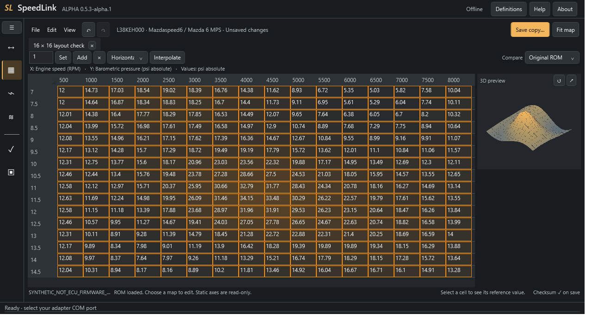
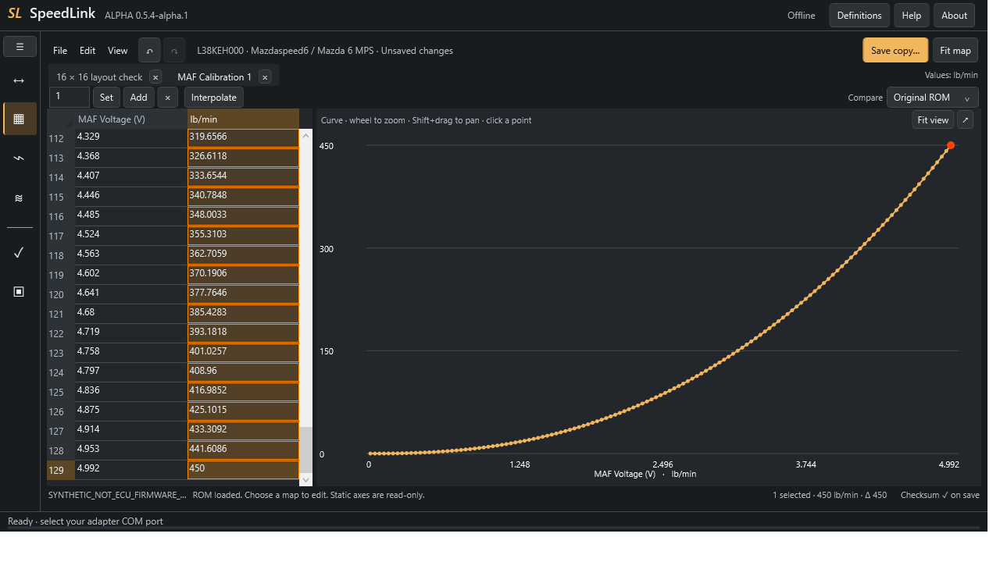
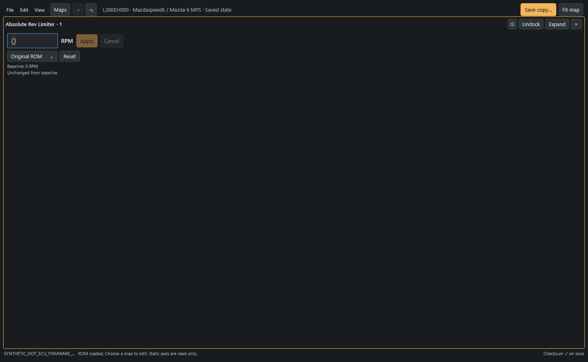
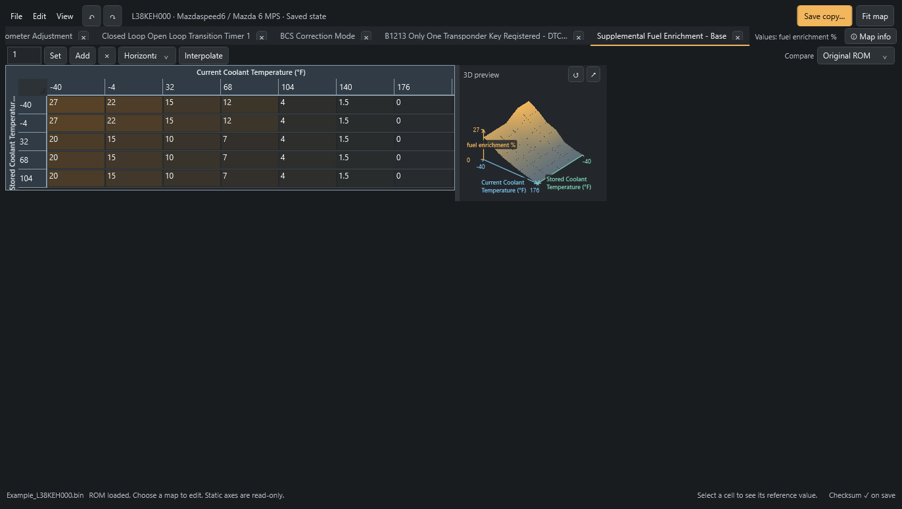
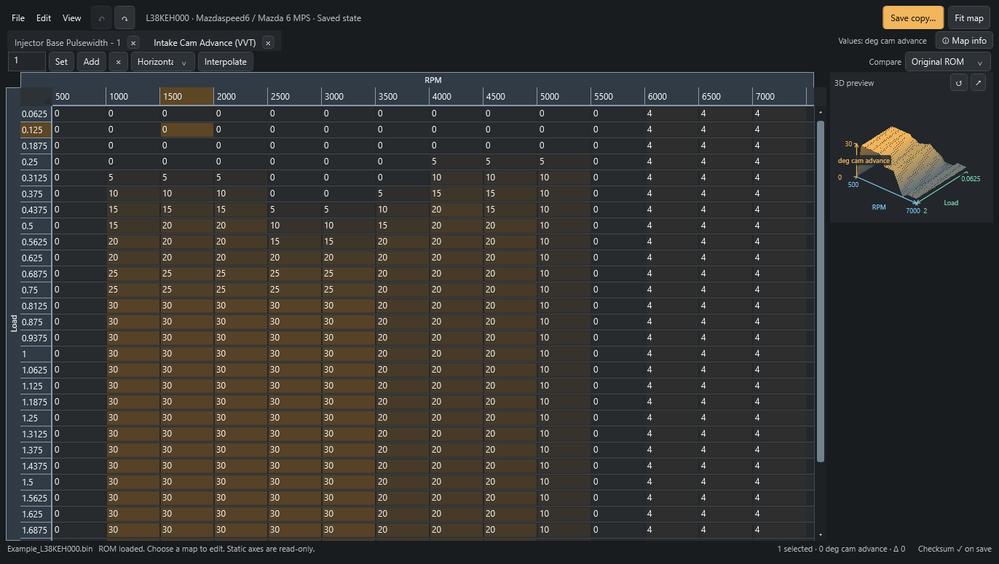
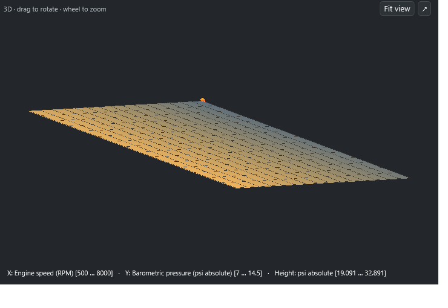
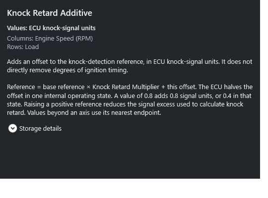

# SpeedLink ROM editor

An offline editor for the nine bundled Mazdaspeed/MPS stock ROM layouts, built
into the same Windows app as the reader and logger. No adapter is needed to edit
a file. ECU programming remains disabled in this alpha. The experimental Gen 2
L3CGEE000 profile has separate [integrity checks and validation limits](../GEN2.md).

## Room for the map

**Fit map** (Ctrl+0) gives the table the available workspace. A full 16×16 map
and both axes fit without table scrollbars at 1024×700 and 1280×720 logical
window sizes with app navigation collapsed. Larger maps retain scrolling.
The ☰ button expands or collapses navigation; Ctrl+B hides or restores the
map browser. Use **View** for layout options and floating panels.

Axis names sit directly above the column breakpoints and beside the row
breakpoints, with value units beside the map tabs. The labels stay visible while
scrolling. Selecting cells highlights their row and column headers.

The 16×16 and MAF examples use synthetic layout/curve fixtures. The 16×16
example is a layout test, not an added stock calibration map. VVT screenshots
show an L38KEH000 ROM example, as do the single-value and small-map screenshots.
These are interface examples, not tuning advice.

## Long MAF curves

Search or browse the map list, keep related maps in separate tabs, and edit
numeric cells directly. Curves use the definition's physical axis values.
Long MAF curves use a voltage/value list beside the graph. Click any point to
reach its value, use the wheel to zoom, and Shift+drag to pan. Static breakpoints
stay read-only. Arithmetic and interpolation work across selected points; copy
and paste retain full precision. Axis names and units label the list's two columns.

## Single values and small maps

Single-value maps use a numeric field with units beside it, an explanation above,
and the comparison value and change below. Type a value and choose **Apply value**
or press Enter. Escape or **Cancel** discards the typed value. **Reset to baseline**
restores the chosen Original ROM, Last save or Comparison ROM value. Undo/Redo
work on applied changes. The field exposes full stored precision when focused.
Invalid or unencodable input stays visible and blocks saving or switching maps
until corrected or canceled. A valid pending value is applied when saving or
switching maps. Single-state maps use a named selector in the same layout.

Small tables use a grid sized to their data, with clear axis bands and readable
cells. Short curves get a curve preview with fewer ticks when space is limited.
Multi-state controls retain their labeled rows without an empty graph.

## Rotatable 3D surfaces

**Table with 3D preview** places the surface at the upper-right of the grid,
keeping the table's full height. **Fit map** retains this preview while a full
16×16 grid fits at both tested sizes. The graph stays on the right, like the
MAF editor. Its controls and linked cell selection work the same way.

Drag the divider at the table's right edge to give the grid or preview more room.
The width is remembered across launches and graph docking. **Fit map** resets it
to the automatic compact preview so a full 16×16 grid can fit again. Short curves
use the same divider, with a wider default preview for readable curve labels.

Axis lines, names and tick values sit directly on the map. Blue is the column
axis, green is the row axis, and amber is the value/height axis. They stay aligned
as you rotate. The preview keeps fewer ticks; the larger graph shows more detail.

Drag to rotate a surface in the direction of your mouse and use the wheel to zoom.
The preview and floating graph use the same controls. Click a point on the
graph to select its grid cell. Resizable panes let you give the grid or graph
more room. **Fit view** frames the entire surface. Pop the graph into a separate
window to use another monitor; closing that window restores the preview.

## Map information and changes

Click **Map info** beside the map tabs, or press **F1**, to open help without
reducing the map's height. Reusing either control brings the same window forward;
it follows the active map when you switch tabs. **View → Map information…**
remains available too. Map info is disabled until a map is selected.
Value units and input axes stay visible above the explanation. Help distinguishes
targets and thresholds from multipliers and signed corrections, with simple
examples. [Map-help conventions](../TUNING_HELP.md) explain the common units.
**Storage details** expands address, data type and dimensions; long content can
be scrolled. Cell tooltips and the status strip show comparison values.
Axis titles and breakpoint headers have a distinct blue-gray band and bright
borders separating them from editable data. Read-only MAF breakpoints use the
same treatment.
**View → Changes** opens a drawer
of maps that differ from the selected baseline. Select a map there to jump to it.

The **View** menu supports table and graph above/beside one another, plus
table-only and graph-only views. The browser can also pop into a separate
window. Layout preferences are remembered. Open maps and unsaved edits remain
in place when switching to Logger or Recordings.

Tabs scroll horizontally and keep the active map visible. Use the mouse wheel
over the tab strip to reach other open maps. Closing a tab keeps the ROM edits.
For step-by-step controls and shortcuts, open **File → Editor guide** in the app
or use the [full editor guide](../EDITOR.md).

## First edit

1. Open **Editor → File → Open ROM…**.
2. Choose a map and check **Map info**. For a single value, type in the field
   and choose **Apply value** or Enter; Cancel or Escape discards typing.
   For a table, double-click a cell, enter a value and press Enter. State
   controls use named choices.
3. Review the original/last-save/comparison values and the curve or surface.
   Use Undo/Redo to restore complete operations.
4. Select **Save copy…**. Every save applies its mandatory checksum/integrity policy, uses
   a new filename and verifies the written bytes.

For a rectangular selection, the toolbar supports Set, Add, Multiply, copy/paste
and horizontal, vertical or 2D interpolation. Mode switches use named choices;
each named DTC bit is exposed separately while neighboring bits are preserved.
See the [full editing guide](../EDITOR.md) for shortcuts and exact behavior.

## Compatibility and current limits

Supported profiles: **L33XEH000, L35HEH000, L38KEH000, L39SED000, L39SEE000,
L39SEF000, L3M7EF000 and L3P4EM000**.

The editor checks the calibration, boot, checksum layout and reference program
signature. Changes to defined tuning controls remain editable; other program
modifications are rejected. Extended/patched ROM layouts are unsupported.

Static axes are read-only. This version has no patch installer, smoothing,
tune-project history or log-to-map overlay. Offline software checks do not
establish vehicle behavior or the suitability of tuning changes.

[All documentation](../README.md) · [Logging](../LOGGER.md) ·
[Validation](../../dotnet/docs/Validation.md) · [Download SpeedLink](https://github.com/mrphyslaw/SpeedLink/releases)
