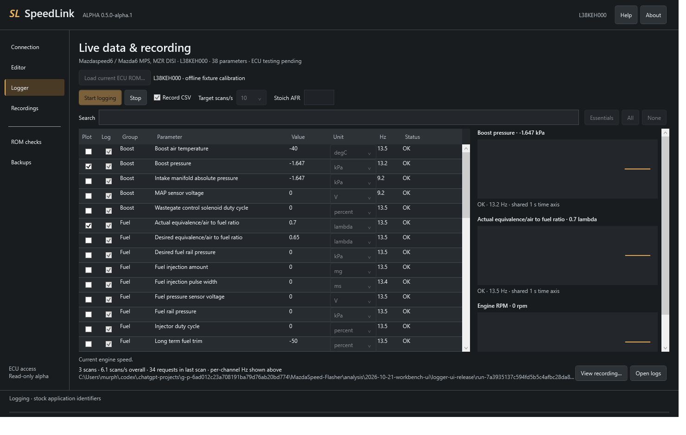

# SpeedLink logger

Choose engine parameters, watch live values and record a CSV for later review.
The logger supports eight stock ROM profiles with 35–38 parameters per profile,
using a Vgate vLinker FS USB or Tactrix Openport 2.0. No logging patch is required.

## Live data and recording

Select the parameters you need, choose display units and leave **Record CSV**
checked to capture the session. Use **Plot** to select up to six synchronized
charts for logged parameters.
The **Hz** column reports each channel's measured rate.

This screenshot comes from an offline test using simulated replies. Its values
and rates are test data. Real Mazda ECU acceptance, readings and logging rates
still need validation.

## Review a saved log

Choose **Recordings** in the left navigation to open a recording without an
adapter. Select up to six channels, move
the shared cursor to inspect readings, and zoom into part of the run. Missing
readings appear as gaps. This screenshot uses the bundled synthetic example log.

## First recording

1. Connect your adapter and select **Connect & identify**.
2. Open **Logger → Load current ECU ROM…** and choose the full ROM backup
   currently installed in the ECU. Its calibration ID must match.
3. Choose **Essentials** or select individual parameters and display units.
4. Leave **Record CSV** checked, select **Start logging**, then **Stop** to finish.
5. Use **Recordings → Open recording…** to open the recording's `log.csv`.

Recordings are stored under `data/logs` beside the EXE. Keep the entire recording
folder when sharing a session for troubleshooting. Fewer selected parameters
allow faster updates. **Target scans/s** is a requested ceiling; achieved rates
depend on the selected parameters, transport and ECU.

Logging can run with the engine running. ROM backup reads require the engine
stopped; disconnect and reconnect after a backup before starting the logger.

See the [full logger guide](../LOGGER.md) for adapter setup, units, rates,
recording files and troubleshooting. Check [profile coverage](../../definitions/logging/All_ROM_Coverage.md)
before connecting an ECU. Unknown ROMs can still be dumped, but logging requires
a supported profile.

[Documentation index](../README.md) · [ROM editor](../editor/README.md) · [Download SpeedLink](https://github.com/mrphyslaw/SpeedLink/releases)

L3P4EM000 adds 35 parameters checked against its own ROM handlers and MAP
calibration bindings. Its live ECU logging, rates and adapter acceptance still
need testing. Desired fuel rail pressure, fuel injection amount and ambient air
temperature are excluded from this profile.
